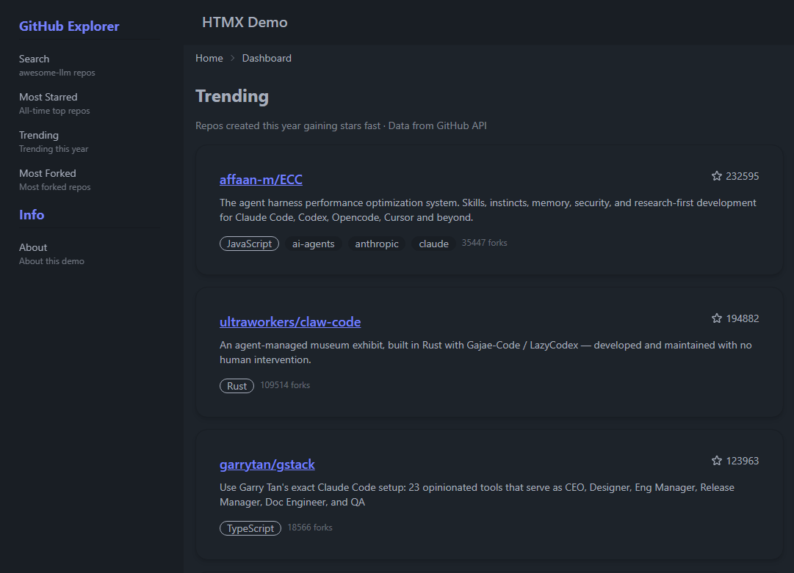

# HTMX Demo — Axum + DaisyUI + GitHub API



A full-featured single-page application demo using **HTMX** with Rust's **Axum** framework, **Tera** templating, **DaisyUI** components, and **Tailwind CSS**.

Instead of a heavy JavaScript framework (React, Vue, etc.), HTMX handles all dynamic page updates via HTML-fragment swaps over HTTP. The server controls both rendering and navigation through a custom middleware layer.

---

## Frameworks & Tools

| Layer | Choice |
|---|---|
| **Backend** | [Axum](https://github.com/tokio-rs/axum) 0.7 — async HTTP framework on top of Tokio |
| **Templating** | [Tera](https://keats.github.io/tera/) — Jinja2/Django-style template engine for Rust |
| **CSS** | [Tailwind CSS](https://tailwindcss.com/) 3.4 + [DaisyUI](https://daisyui.com/) 4 — utility-first CSS with pre-built components |
| **Frontend** | [HTMX](https://htmx.org/) 2.0 — AJAX-driven HTML swapping, no JavaScript framework |
| **HTTP Client** | [reqwest](https://docs.rs/reqwest/) — for live GitHub API data |
| **Fake Data** | ~none— removed in favor of live API data |

---

## Architecture

### SPA via HTMX + Middleware

The app uses a **custom Axum middleware** (`response_middleware`) to handle whether to return a full HTML page or just an HTML fragment:

1. **HTMX request** (clicking a sidebar link) → the middleware renders only the content fragment (e.g. the repo card grid) and returns it directly.
2. **Full page navigation** (URL bar, refresh) → the middleware renders the content fragment, then **wraps it inside `index.html`** using `{{ content | safe }}`, serving the complete page shell with navbar, sidebar, and footer.

This means fragment templates (`github.html`, `about.html`) contain **only the content** — no layout boilerplate.

### GitHub API Data

Four views fetch live data from the [GitHub REST API](https://docs.github.com/en/rest) (no authentication required, 60 requests/hour limit):

| View | API Query | Cache |
|---|---|---|
| `/repos` | `q=awesome-llm&sort=stars` | 5 min |
| `/repos/starred` | `q=stars:>1000&sort=stars` | 5 min |
| `/repos/trending` | `q=created:>2026-01-01&sort=stars` | 5 min |
| `/repos/forked` | `q=forks:>1000&sort=forks` | 5 min |

Results are cached in-memory for 5 minutes to stay under the rate limit.

### Theme System

Four DaisyUI themes cycle via a button in the navbar: **light → dark → cupcake → retro**. The chosen theme is persisted in `localStorage`.

---

## Project Structure

```
├── Cargo.toml                Rust dependencies and metadata
├── package.json              Node dependencies (Tailwind + DaisyUI)
├── tailwind.config.js        Tailwind + DaisyUI configuration
├── static/
│   ├── input.css             Tailwind input (directives)
│   └── output.css            Generated CSS (do not edit)
├── src/
│   ├── main.rs               Entry point, AppState, template registration
│   ├── routes.rs             All route handlers + GitHub API fetching
│   └── response.rs           HxResponse struct + middleware
└── templates/
    ├── index.html            Shell layout (navbar, sidebar, footer)
    ├── welcome.html          Landing page (/)
    ├── about.html            About page
    ├── 404.html              404 fallback
    └── github.html           Reusable GitHub repo card grid
```

---

## Running the Application

### Prerequisites

- [Rust](https://rustup.rs/) (edition 2021)
- [Node.js](https://nodejs.org/) (for Tailwind CSS build)

### Commands

```sh
# Install Node dependencies (one time)
npm install

# Build the CSS
npm run build:css

# Start the server
cargo run

# Watch mode (auto-restart on Rust changes)
cargo watch -c -x run
```

Then open **http://localhost:3000** in your browser.

### When to Rebuild CSS

Run `npm run build:css` **whenever you add new CSS class names to any `.html` file** in `templates/`. This is required because Tailwind scans your templates and only generates the utility classes it finds.

A full workflow cycle looks like:

```sh
# 1. Edit a template — add new DaisyUI/Tailwind classes
# 2. Rebuild the CSS (scans templates for class names)
npm run build:css

# 3. Rebuild and restart the Rust server (CSS is embedded at compile time)
cargo build && cargo run
```

The `cargo build` step is needed because the CSS file is embedded into the Rust binary via `include_str!` in `src/routes.rs`.

---

## License

MIT — see [LICENSE](./LICENSE).
